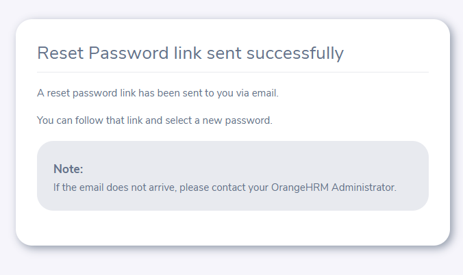
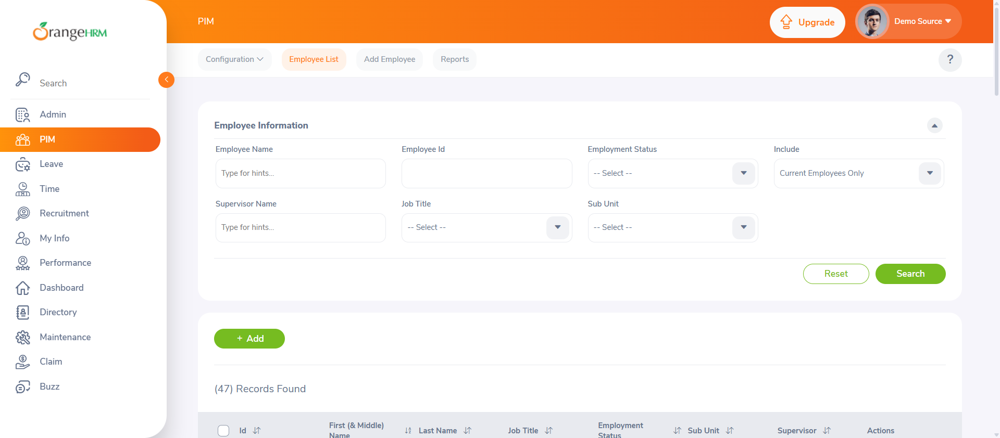
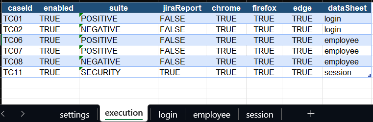
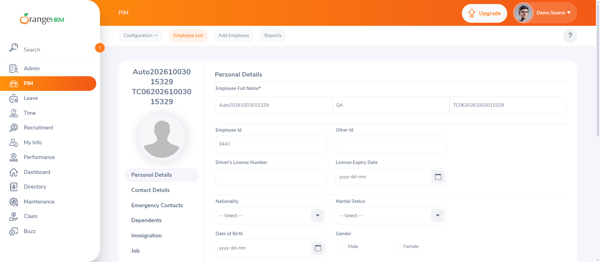
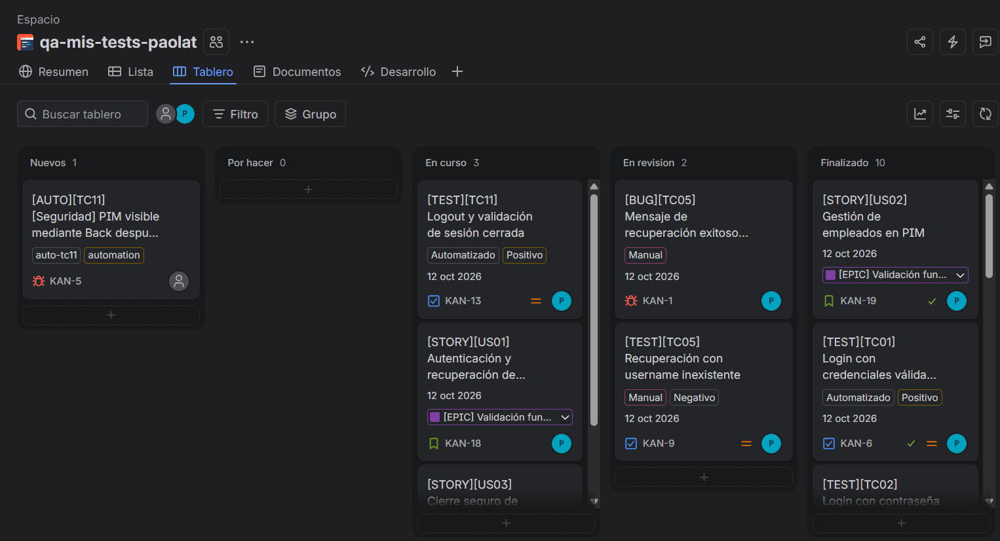
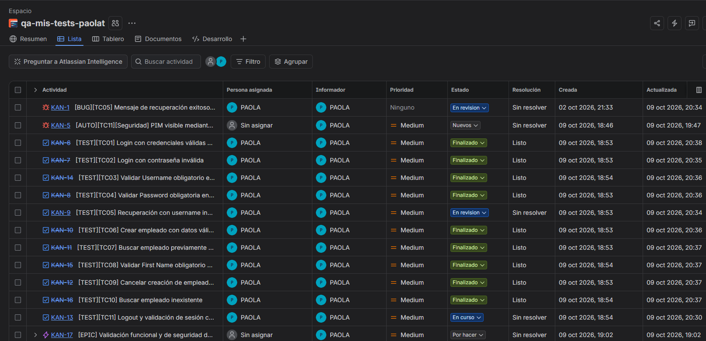

# OrangeHRM QA Testing & Web Automation

Proyecto de aseguramiento de calidad para validar la instancia pública de
OrangeHRM mediante pruebas manuales y automatizadas, ejecución Data-Driven,
validación multibrowser, evidencia técnica y trazabilidad de defectos.

## Resumen ejecutivo

- **Sistema evaluado:** OrangeHRM Open Source Demo.
- **Alcance funcional:** autenticación, recuperación de contraseña, gestión de empleados y cierre de sesión.
- **Casos diseñados:** 11 (6 automatizados y 5 manuales).
- **Regresión automatizada:** 18 ejecuciones, 16 PASS, 2 FAIL y 0 SKIP.
- **Navegadores:** Chrome, Firefox y Edge.
- **Defectos documentados:** KAN-1 (TC05) y KAN-5 (TC11).
- **Enfoque técnico:** Java, Selenium WebDriver, TestNG, Maven, Page Object Model y datos administrados desde Excel.

## Objetivo

Validar flujos críticos de OrangeHRM con pruebas mantenibles y trazables. El framework separa los datos, los pasos funcionales, la interacción con la página, los localizadores y las aserciones. Las capturas complementan las validaciones, pero no determinan por sí solas el resultado de una prueba.

## Alcance y casos de prueba

| Caso | Tipo | Modalidad | Escenario | Resultado final |
|---|---|---|---|---|
| TC01 | Positivo | Automatizado | Login con credenciales válidas | PASS |
| TC02 | Negativo | Automatizado | Login con contraseña inválida | PASS |
| TC03 | Negativo | Manual | Username obligatorio | PASS |
| TC04 | Negativo | Manual | Password obligatorio | PASS |
| TC05 | Negativo | Manual | Recuperación con usuario inexistente | Hallazgo KAN-1 |
| TC06 | Positivo | Automatizado | Crear empleado con datos válidos | PASS |
| TC07 | Positivo | Automatizado | Buscar empleado creado por ID | PASS |
| TC08 | Negativo | Automatizado | First Name obligatorio | PASS |
| TC09 | Negativo | Manual | Cancelar creación de empleado | PASS |
| TC10 | Negativo | Manual | Buscar empleado inexistente | PASS |
| TC11 | Seguridad | Automatizado | Logout y navegación Back | Hallazgo KAN-5 |

## Resultado de la regresión

La suite ejecutó los seis casos automatizados en tres navegadores:

| Navegador | Ejecuciones | PASS | FAIL |
|---|---:|---:|---:|
| Chrome | 6 | 5 | 1 |
| Firefox | 6 | 6 | 0 |
| Edge | 6 | 5 | 1 |
| **Total** | **18** | **16** | **2** |

Los dos fallos corresponden a TC11 en Chrome y Edge. Firefox mantuvo el comportamiento esperado.

## Hallazgos documentados

### KAN-1 — TC05: recuperación para usuario inexistente

OrangeHRM muestra el mensaje `Reset Password link sent successfully` después de ingresar un username inexistente. El caso fue documentado para analizar si el mensaje representa el comportamiento esperado del producto o una comunicación engañosa para el usuario.



### KAN-5 — TC11: contenido PIM visible después del logout

Después de cerrar sesión y usar Back, Chrome y Edge vuelven a mostrar contenido PIM almacenado en caché. La navegación directa a una URL protegida sí exige autenticación, por lo que el alcance del hallazgo es **exposición visual de contenido cacheado**; no se afirma que exista una sesión activa ni una vulnerabilidad de autorización confirmada.



## Arquitectura

```text
TestData.xlsx
      |
      v
TestNG + DataProviders --> test_steps --> page_objects --> page_locators
          |                   |               |
          |                   |               +--> Selenium WebDriver
          |                   +--> aserciones y lenguaje funcional
          +--> filtros de suite/navegador, evidencia y Jira
```

```text
src/main/java/page_base/       Comportamiento común de los Page Objects
src/main/java/page_locators/   Localizadores centralizados por página
src/main/java/page_objects/    Acciones de Login, Dashboard y empleados
src/test/java/page_base/       Ciclo de vida del WebDriver
src/test/java/page_tests/      Orquestación mínima de los casos TestNG
src/test/java/test_steps/      Pasos funcionales legibles y aserciones
src/test/java/page_utils/      Excel, filtros, evidencia, capturas y Jira
src/test/resources/            Matriz y datos de prueba
testing.xml                    Suite de regresión multibrowser
```

La capa `test_steps` mantiene los métodos de prueba cercanos al lenguaje natural sin incorporar Cucumber ni una dependencia adicional. Los tests describen el flujo; los Page Objects controlan Selenium; y las clases de localizadores concentran los selectores usados por cada página.

## Ejecución Data-Driven

`src/test/resources/TestData.xlsx` contiene cinco hojas:

- `settings`: selecciona `ALL`, `POSITIVE`, `NEGATIVE` o `SECURITY`.
- `execution`: controla caso, suite, Jira y navegador.
- `login`: entradas y resultados esperados de TC01 y TC02.
- `employee`: datos de TC06, TC07 y TC08.
- `session`: condiciones y resultados esperados de TC11.



Los datos dinámicos de empleados reciben un sufijo temporal para evitar colisiones en la demo compartida. Excel no almacena tokens ni credenciales personales.

## Estrategia multibrowser

`testing.xml` declara Chrome, Firefox y Edge en ejecución secuencial. Antes de crear cada WebDriver, `ExecutionFilter` consulta la suite seleccionada y las columnas `enabled`, `chrome`, `firefox` y `edge` de Excel. Esto permite controlar la regresión sin modificar el código.

Las esperas se basan en estados visibles y funcionales de la aplicación. No se utilizan pausas fijas para ocultar problemas de sincronización. Selenium Manager resuelve los drivers de los navegadores.

## Evidencias y trazabilidad

`EvidenceReporter` registra caso, navegador, validación, esperado, actual y resultado. `ScreenshotHelper` prepara el estado visual y guarda capturas con el caso y navegador en el nombre. Las aserciones TestNG son la fuente del PASS/FAIL.



Los casos, historias y defectos se organizaron en Jira dentro de un Epic de validación funcional y de seguridad. Los defectos se vincularon con su caso de prueba para conservar trazabilidad.





## Integración con Jira

La creación o actualización automática requiere tres autorizaciones simultáneas:

1. `jira.enabled=true` en la configuración local.
2. `jira.auto.create=true` en la configuración local.
3. `jiraReport=TRUE` para el caso en Excel.

Antes de crear una incidencia, `JiraReporter` busca un issue abierto del mismo `caseId`. Si existe, reutiliza la incidencia y agrega solo la evidencia o el navegador faltante; si no existe, crea una nueva. Así se evita generar un ticket por cada navegador o ejecución.

## Requisitos

- Java 25.
- Maven 3.9 o posterior.
- Chrome, Firefox y Edge.
- Acceso a Internet para dependencias y OrangeHRM Demo.

## Configuración local

Copiar el archivo de ejemplo:

```powershell
Copy-Item config.example.properties src/test/resources/config.properties
```

Completar únicamente la copia local. `src/test/resources/config.properties` está excluido mediante `.gitignore` y nunca debe confirmarse en Git.

La prioridad de configuración es: propiedad Java (`-Dclave=valor`), variable de entorno, archivo local y valor por defecto. Jira permanece desactivado por defecto.

## Ejecución

Desde la raíz del proyecto:

```powershell
mvn clean test
```

En Eclipse: clic derecho en `testing.xml` y `Run As > TestNG Suite`. Para obtener la regresión completa no se debe ejecutar una clase individual.

Los reportes y capturas se generan en `target/` y `test-output/`, ambos ignorados por Git.

## Seguridad

- No versionar `config.properties`, tokens de Jira ni credenciales personales.
- No imprimir passwords o tokens en consola.
- Mantener Jira desactivado salvo cuando se quiera reportar una incidencia real.
- Revisar `git status` y el diff preparado antes de cada commit.
- Usar secretos del entorno cuando el proyecto se ejecute en CI.

## Limitaciones

- OrangeHRM es una demo pública: puede cambiar, responder lentamente o contener datos creados por otros usuarios.
- TC11 depende del comportamiento de caché de cada navegador.
- La evidencia visual no reemplaza una validación funcional.
- Los textos visibles solo se validan literalmente cuando forman parte del requisito, para reducir fallos por idioma.

## Capacidades cubiertas

El alcance técnico incluye diseño de casos, automatización web, manejo de datos,
validación cross-browser, análisis de defectos y trazabilidad con Jira. Los casos
delegan sus acciones en pasos funcionales y Page Objects reutilizables.

## Tecnologías

Java 25 · Selenium WebDriver 4.49 · TestNG 7.10 · Maven · Apache POI · Jira Cloud · Git · GitHub

## Estado del proyecto

La suite automatizada cubre seis casos en Chrome, Firefox y Edge. Los resultados,
hallazgos, evidencias y limitaciones de la ejecución se encuentran documentados
en este repositorio.
